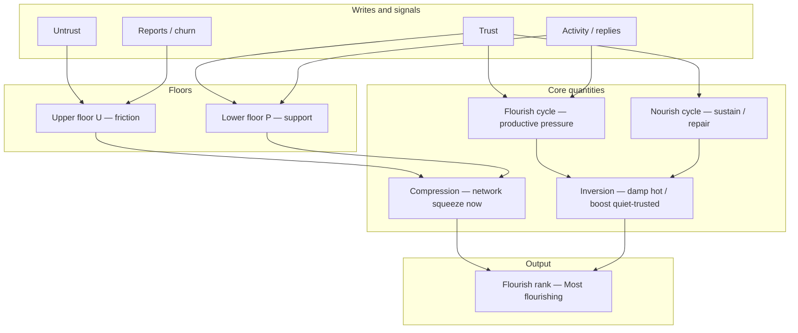

# ORRO Idea Paper — Algorithm Math Addendum

Summary: Compression, Flourish, Nourish, and Inversion

Focus: Ranking and analysis layer for creative objects and groups in agentic networks (the harmonisation effect).

| Version | Description |
|------|----------------|
| 1.6.1 | Math & terminology update |

## 1. Purpose

This note defines the four core quantities used by the ORRO flourish engine:

| Term | Plain meaning |
|------|----------------|
| **Compression** | How hard the network is squeezing the object *now* (trust pressure vs friction). |
| **Flourish cycle** | Rising *productive* pressure (growth, contribution, healthy activity). |
| **Nourish cycle** | Sustaining / *repair* pressure (support after dips, recovery of quiet but trusted work). |
| **Inversion** | Policy that *damps hot spikes* and *boosts recovery* of trusted but quiet work. |

Together they implement **Resistance ranking**: trend and “most flourishing” are not raw popularity; they are structured pressure under trust.

## 2. Terminology

| Symbol / term | Meaning |
|---------------|---------|
| Object | A project, fragment, post, tag, certificate, token, or group. |
| \(P\) | Popularity pressure — attention and support. |
| \(U\) | Unpopularity / friction pressure — Untrust, reports, neglect, churn. |
| Trust / Untrust | Explicit user (or agent) writes; one state per actor per object. |
| Window | Time horizon by type: tags 24h; posts 7d; projects, fragments, certificates, groups 30d. |
| \(\varepsilon\) | Small positive constant to avoid division by zero. |
| Baseline | Reference level for “hot” vs “quiet” (e.g. recent median score for that object type). |

**Compression**  
Gap between an upper floor (friction \(U\)) and a lower floor (support \(P\)).  
Tighter gap → stronger trend / stronger “network squeeze.”

**Flourish cycle**  
Time series of *productive* pressure: Trust-weighted activity, quality contribution, sustained engagement.

**Nourish cycle**  
Time series of *support/repair* pressure: Trust after a dip, Untrust reversal, helper actions, re-engagement of trusted quiet work.

**Inversion**  
When the object is **hot** (well above baseline), extra flourish is damped.  
When the object is **quiet but trusted** (below baseline, still high Trust ratio), nourish is boosted so recovery is possible without pure virality.

## 3. Base signals (per object, inside its window)

$$
\begin{aligned}
\text{Pop} &= f(\text{active members or engagers},\;\text{activity rate}) \\
\text{Friend} &= f(\text{reply quality},\;\text{low conflict},\;\text{mutual ties}) \\
\text{TrustSig} &= f(\text{net Trusts},\;\text{Trust ratio},\;\text{low Untrusts})
\end{aligned}
$$

## 4. Compression (Resistance core)

Upper floor and lower floor:

$$
\begin{aligned}
U &= w_U \cdot \text{Untrusts} + w_R \cdot \text{reports} + w_C \cdot \text{churn} + \cdots \\
P &= w_T \cdot \text{TrustSig} + w_A \cdot \text{Trust-weighted activity}
\end{aligned}
$$

Compression (smaller gap = stronger squeeze):

$$
\text{Gap} = U - P + \varepsilon
$$

$$
\text{Compression} = \frac{1}{\text{Gap}}
$$

Optional rank form (same story):

$$
\text{Flourish}_{\text{resist}} \propto \frac{\text{Trust-weighted activity}}{\text{Untrust} + \text{reports} + \text{churn} + \varepsilon}
$$

## 5. Flourish cycle and Nourish cycle

**Flourish cycle** (productive pressure over the window):

$$
\text{FlourishCycle}(t) = \alpha \cdot \text{TrustSig}(t) + \beta \cdot \text{Pop}(t) + \gamma \cdot \text{Friend}(t)
$$

**Nourish cycle** (sustain / repair pressure):

$$
\text{NourishCycle}(t) = \alpha_n \cdot \text{TrustAfterDip}(t) + \beta_n \cdot \text{UntrustReversal}(t) + \gamma_n \cdot \text{Reengagement}(t)
$$

Coefficients \(\alpha, \beta, \gamma\) and \(\alpha_n, \beta_n, \gamma_n\) are tunable; Trust terms should dominate.

## 6. Inversion policy

Let \(B\) be the baseline for that object type in the window.  
Let \(S(t)\) be a simple combined level, e.g. \(\text{FlourishCycle}(t)\).

$$
\begin{aligned}
\text{if } S(t) &> B + \delta &\rightarrow &\quad \text{hot: damp flourish gains} \\
\text{if } S(t) &< B - \delta \;\land\; \text{TrustRatio high} &\rightarrow &\quad \text{quiet-trusted: boost nourish}
\end{aligned}
$$

Example applied score:

$$
\text{FlourishCycle}' = \text{FlourishCycle} \cdot D_{\text{hot}}
$$

$$
\text{NourishCycle}' = \text{NourishCycle} \cdot B_{\text{recover}}
$$

where \(D_{\text{hot}} \in (0,1]\) (damper) and \(B_{\text{recover}} \ge 1\) (boost).

## 7. Combined ranking score (Alpha-ready)

Linear blend (stable default):

$$
\text{Flourish} = w_T \cdot \text{TrustSig} + w_F \cdot \text{Friend} + w_P \cdot \text{Pop}
$$

**Starting weights (tunable)**

| Weight | Value | Reason |
|--------|-------|--------|
| \(w_T\) Trust | **0.50** | Core ORRO differentiator |
| \(w_F\) Friendliness | **0.30** | Climate, not just size |
| \(w_P\) Popularity | **0.20** | Needed, but not dominant |

With cycles and compression:

$$
\text{FlourishFinal} = \theta_1 \cdot \text{Compression} + \theta_2 \cdot \text{FlourishCycle}' + \theta_3 \cdot \text{NourishCycle}'
$$

with \(\theta_1 + \theta_2 + \theta_3 = 1\), and Trust still the main driver inside each term.

Decay: after the object’s window (24h / 7d / 30d), trend contribution goes to zero; history may remain for audit.

## 8. Mermaid diagram (conceptual engine)

## 9. Design rules (short)

One Trust or Untrust per actor per object (toggle).
Trust/Untrust update scores immediately; decay runs on a timer.
Windows: tags 24h; posts 7d; projects, fragments, certificates, groups 30d.
Compression resists pure virality; Inversion resists both empty spikes and permanent burial of trusted quiet work.
Weights and $\theta$ are tunable; Trust remains the primary differentiator.

## 10. Relation to agentic networks

Compression + Flourish/Nourish + Inversion give a shared pressure field that humans and agents can write (Trust/Untrust) and read (rank). That supports harmonisation: ranking by structured trust pressure rather than attention alone.
