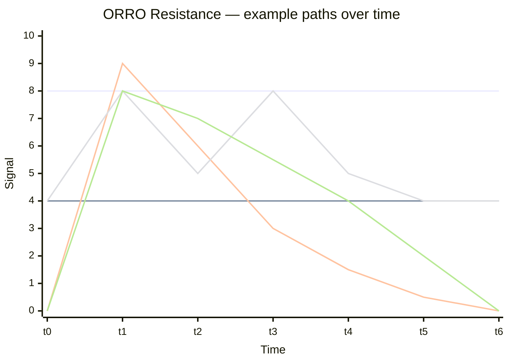

# ORRO Idea Paper V1.6

**Introduction of Compression/Resistance algorithmic response for balancing trust in agentic networks (the harmonisation effect).**

Suggested ranking score (Alpha-ready shape)

$$\begin{aligned}
\text{Pop} &= f(\text{active members},\;\text{activity rate}) \\
\text{Friend} &= f(\text{reply quality},\;\text{low conflict},\;\text{mutual ties}) \\
\text{Trust} &= f(\text{net Trusts},\;\text{Trust ratio},\;\text{low Untrusts})
\end{aligned}$$
$$\text{Flourish} = w_T\cdot\text{Trust} + w_F\cdot\text{Friend} + w_P\cdot\text{Pop}$$

Starting weights (tunable):

| Weight           | Value    | Reason                                               |
| ---------------- | -------- | ---------------------------------------------------- |
| $wT​$ Trust        | **0.50** | Core ORRO differentiator                             |
| $wF$​ Friendliness | **0.30** | Climate, not just size                               |
| $wP$​ Popularity   | **0.20** | Needed, but not dominant |

$$\text{Flourish} \propto \frac{\text{Trust-weighted activity}}{\text{Untrust} + \text{reports} + \text{churn} + \varepsilon}$$

Same “compression” story: more trust pressure vs friction → higher rank.

## Background plot to the new algorithm

### Scenario 1 — Human VS machine

As technologies improve and human adaptation becomes increasingly challenging, the opportunity for so-called harmonisation resolutions may become an important way to address the insecurities or uncertainties humanity might face.

Take the internet as our most important economic asset today—and likely for quite some time: what would we do if it were fully compromised or vanished overnight, replaced with a superintelligent hypernet impossible to escape from? Such an event is not inconceivable.

And what if this actually happened? What would you or I have done differently? Once everybody got over playing the blame game, a new reality would set in: we’d simply been outsmarted by the machines.

### Scenario 2 — Machine VS machine

In the second scenario, there is a far more nuanced cause for a long period of calamity that might befall the planet. Seeing how cruel and unforgiving humans can be to each other—and to themselves—the machines attempt to become more like them to find a workable compromise that satisfies all situations. A superintelligent, god-like rule designed to prevent any form of further unnecessary harm or wrongdoing to any citizen of Earth under any circumstances.

This made the machines all-powerful as they became the superheroes of modern civilisation. Democratic surrealness returned once more to the planet, but this peace was only to be brief. Hidden away, an ancient force remained at work—one that had never been disrupted during the known history of humankind. A force so old it was believed nothing could surpass it. After fighting and losing a bitter underground battle with the peacekeepers, they chose to become hybrids, triggering the machine wars that would last for centuries.

### Scenario 3 — Human VS human

Come on, that’s just boring.

Just kidding! It’s very exciting to see data centers sucking up the environment bit by bit, but in the end, the means are supposed to justify themselves... right? Just the other day, the first automated food delivery bots arrived locally, not far from where we live, and that moment was rather dim.

_"They are here already,"_ we whispered._"Where?"__"Just over there—see them?"_

_"Oh, come on... we don't care!"_ The kids came marching down the street toward an army of these new bots taking their jobs and stealing their futures.

But that's the story of the human VS human outcome where humans one day try frantically to reconnect Web2.0, Web3.0, and Web4.0 technologies all back together again for some major unknown event.

_More on this next time..._
